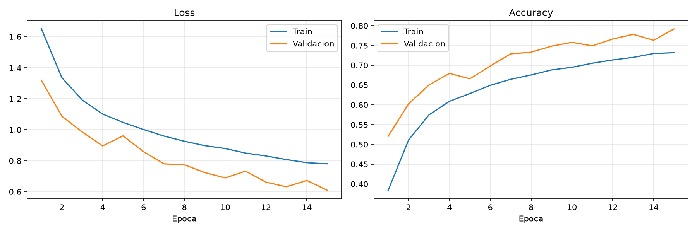
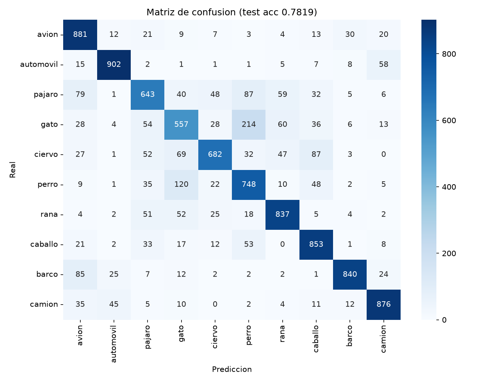

# Clasificación de imágenes CIFAR-10 con CNN (PyTorch)

**Estudiante:** Jose Antonio Condori Cruz
**Código de matrícula:** 022100244D
**Semilla:** 44 (`torch.manual_seed(44)`, `np.random.seed(44)`, `random.seed(44)`)

## Estructura y ejecución

```
src/dataset.py            # carga, transformaciones, partición y visualización
src/model.py              # arquitectura CNN y validación de shapes
src/train.py              # entrenamiento, métricas y gráficos
notebooks/experiment.ipynb
outputs/                  # loss_accuracy.png, confusion_matrix.png, metrics.json
```

```bash
pip install -r requirements.txt
python src/dataset.py
python src/model.py
python src/train.py
```

## Pregunta 2.1: Por qué un MLP es ineficiente en CIFAR-10

Una imagen de CIFAR-10 mide 32×32×3 = 3072 valores. Un MLP necesita aplanarla en un vector, lo que genera tres problemas:

1. **Explosión de parámetros:** una sola capa densa 3072→1024 ya tiene cerca de 3.1 millones de pesos, y el costo crece con la resolución de la imagen.
2. **Pérdida de estructura espacial:** al aplanar, los píxeles vecinos y los lejanos se tratan igual, y el MLP no sabe que un borde está formado por píxeles contiguos.
3. **Sin invarianza a la traslación:** un objeto desplazado unos píxeles produce un vector distinto, por lo que el MLP necesita más datos y tiende al sobreajuste.

Las CNN resuelven estas limitaciones con tres propiedades:

- **Conexiones locales:** cada neurona observa solo una ventana (3×3), captura bordes y texturas, y las capas profundas los combinan en patrones complejos.
- **Weight Sharing:** el mismo filtro se desliza por toda la imagen. Una `Conv2d(3, 32, 3)` tiene solo 3·32·9 + 32 = 896 parámetros, sin importar el tamaño de la imagen.
- **Invarianza espacial:** el filtro detecta un patrón en cualquier posición, y `MaxPool2d` aporta tolerancia a pequeños desplazamientos y reduce la resolución.

## Pregunta 2.2: Arquitectura de la CNN

| # | Capa | Salida (B, C, H, W) |
|---|------|---------------------|
| 0 | Entrada | (B, 3, 32, 32) |
| 1 | Conv2d(3→32, k=3, p=1) + BatchNorm + ReLU | (B, 32, 32, 32) |
| 2 | MaxPool2d(2) | (B, 32, 16, 16) |
| 3 | Conv2d(32→64, k=3, p=1) + BatchNorm + ReLU | (B, 64, 16, 16) |
| 4 | MaxPool2d(2) | (B, 64, 8, 8) |
| 5 | Conv2d(64→128, k=3, p=1) + BatchNorm + ReLU | (B, 128, 8, 8) |
| 6 | MaxPool2d(2) | (B, 128, 4, 4) |
| 7 | Flatten | (B, 2048) |
| 8 | Linear(2048→256) + ReLU + Dropout(0.5) | (B, 256) |
| 9 | Linear(256→10) | (B, 10) |

Con kernel 3, padding 1 y stride 1, la convolución conserva el tamaño espacial. Cada `MaxPool2d(2)` lo reduce a la mitad (32→16→8→4). El valor 2048 de la capa `Linear` sale de 128 × 4 × 4. El modelo tiene **620,810 parámetros entrenables**.

## Configuración del entrenamiento

- Pérdida: `CrossEntropyLoss`. Optimizador: `Adam` (lr = 1e-3). Épocas: 15. Batch: 128.
- Particiones: 45,000 train / 5,000 validación (estratificada, 10 %) / 10,000 test.
- Data Augmentation (solo en train): `RandomCrop(32, padding=4)` y `RandomHorizontalFlip`. Todas las particiones usan `ToTensor` y `Normalize`.

## Pregunta 4: Análisis crítico de las métricas (semilla 44)

| Métrica | Valor |
|---|---|
| Train accuracy final | 73.18 % |
| Val accuracy final | 79.18 % |
| Test accuracy | 78.19 % |
| Train loss final | 0.7800 |
| Val loss final | 0.6094 |
| Brecha train − val (accuracy) | −6.0 pp |




**Overfitting o underfitting.** El modelo no presenta overfitting: la loss de validación baja junto con la de entrenamiento durante las 15 épocas y no aparece la divergencia característica del sobreajuste. La accuracy de validación (79.18 %) supera a la de entrenamiento (73.18 %), con una brecha de −6 pp. Esto se explica porque el Data Augmentation y el Dropout (0.5) solo actúan en entrenamiento, y porque la accuracy de train es un promedio durante toda la época, mientras que la de validación se mide con el modelo ya actualizado. La accuracy de test (78.19 %) difiere en solo 1 pp de la de validación, lo que indica buena generalización.

Las curvas siguen con tendencia ascendente en la época 15, así que hay un posible subajuste leve: el modelo aún no ha convergido y se beneficiaría de más épocas o de menos regularización.

**Rendimiento por clase.** Las mejores clases son automóvil (F1 = 0.90), barco (0.88) y camión (0.87), objetos de formas rígidas y distintivas. La peor es gato (F1 = 0.59, recall 0.56), seguida de pájaro (0.68) y perro (0.69). [Completa con lo que veas en tu matriz: en la fila "gato", ¿qué clase recibe más predicciones erróneas? Escribe ese par de clases con sus valores.]

## Observaciones adicionales

- El dataset está balanceado (5,000 imágenes por clase en train), por lo que la accuracy no se distorsiona por desbalance.
- Los resultados son reproducibles con la semilla 44.